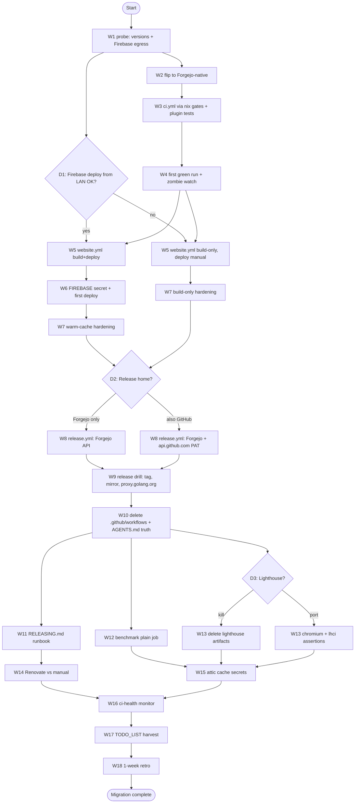

# Forgejo CI Migration — Pareto Execution Plan

> **Date:** 2026-10-25 17:13
> **Subject:** Migrate all gogenfilter GitHub Actions (ci, website, benchmark, lighthouse, release) to the local Forgejo runner on evo-x2.
> **Motivation:** GitHub Actions is billing-dead since 2026-09-08 (`SystemNix/docs/services/ci-watchdog.md`); the repo currently has NO working CI of record.
> **Inputs:** `docs/status/2026-10-25_16-57_forgejo-migration-assessment-self-review.md` (assessment + 50-item backlog + 3 questions), `TODO_LIST.md`, prior plan `2026-08-10_16-45_pareto-execution-plan.md`, `SystemNix` primary sources.
> **Format:** `.md` with mermaid graph at explicit user instruction (skill default is HTML).

---

## 0. Verified facts (primary sources — do not re-litigate)

| # | Fact | Source |
|---|------|--------|
| V1 | Runner: forgejo-runner v13.2.0, host executor, label `native`, capacity 2, no Docker. Jobs say `runs-on: native` | `SystemNix/modules/nixos/services/forgejo.nix:96-113` |
| V2 | Runner unit PATH: nix, jq, python3, go, git, nodejs, gzip, gnutar, gcc, curl — **no `bc`** | `forgejo.nix:1318-1332` |
| V3 | `ProtectSystem=strict`; only `/mnt/buildcache/ci-runner-cache` is RW. Warm caches: `GOMODCACHE`, `GOCACHE`, `npm_config_cache` → `/mnt/buildcache/ci-runner-cache/*` | `forgejo.nix:1334-1344` |
| V4 | Egress to `proxy.golang.org` works (module registry pulls canonical zips from it); npm/node workspace builds run on this runner | `SystemNix/docs/services/forgejo.md:452+`, `344+` |
| V5 | Flip procedure: `forgejo-flip-check@gogenfilter` (dry-run) → `forgejo-flip@gogenfilter` (executes migrate with `service: "github"`, full import incl. **releases**, attaches push mirror 8h + sync_on_commit). Mid-flip failure recoverable | `forgejo.md:106-126` |
| V6 | **Secrets do NOT migrate.** Mint tokens via `forgejo admin user generate-access-token`; set repo Actions secrets manually | `forgejo.md:344-384` |
| V7 | `actions/checkout@v7` fails clone auth on this runner; pin v4.2.2 by SHA `11bd71901bbe5b1630ceea73d27597364c9af683` (hub evidence) | `eventcatalog-hub/.forgejo/workflows/build.yml` |
| V8 | `nix flake check` already runs green on this runner (domains pilot, flipped 2026-10-16) | `forgejo.md:277+` |
| V9 | Forgejo v15.0.10 supports `on.push.paths`, `concurrency`, automatic `GITHUB_TOKEN`; `permissions:` key unsupported (warns) | forgejo.org docs (fetched 2026-10-25) |
| V10 | md-go-validator is a **public** `github:` flake input; `website/flake.nix` builds it locally with a vendorHash override; GitHub CI runs `nix run .#validate-docs` in `website/` with no secrets → works on any nix+egress runner | `website/flake.nix`, `.github/workflows/website.yml` |
| V11 | Known regression: v15.0.10 Actions log-transfer zombie runs (#14843; fix PR 14856 pending) — watch first runs | `forgejo.md` research notes |
| V12 | After flip, push-mirror PAT needs `workflow` scope while `.github/workflows/` files exist; ANY GitHub-side push from another clone (macOS!) is a clobber risk | `forgejo.md:307-317` |

## 0.1 Open unknowns (probe/decide inside the plan)

- U1: Egress to `firebase.googleapis.com` / `storage.googleapis.com` (V4 covers golang.org + npm only) → **W1 probe**.
- U2: Host `go`/`node` exact versions on PATH (V2 lists packages, not versions) → **W1 probe**.
- U3: Firebase deploy from a LAN-only home server — policy decision → **question g-2**.
- U4: Release home after migration (push mirror does NOT sync releases back to GitHub) → **question g-1**.

## 0.2 Errata (corrections to stale sources — recorded so future sessions aren't misled)

1. **AGENTS.md CI section is stale**: claims website CI does a "cross-repo checkout for md-go-validator with `PRIVATE_REPO_TOKEN`" — current `website.yml` has NO checkout step; validation runs via the website flake's nix app. Fix scheduled in W10.
2. **Status report (16:57) corrections**: egress unknown partially resolved (V4); "release strategy consequence missed" resolved — the flip IMPORTS release history (V5); flake-input fetchability concern resolved (V10).
3. **Prior plan (2026-08-10)**: "Pin GitHub Actions to SHA hashes" is DONE (all workflows SHA-pinned). Not re-planned.
4. **TODO_LIST**: "Add plugin CI job" still open — folded into W3. "art-dupl@v0.3.0 doesn't compile" still true — keep CI pin at v0.1.0 (already the case).

---

## 1. Pareto Breakdown

### The 1% that delivers 51%

**Flip the repo + one consolidated `.forgejo/workflows/ci.yml` running the nix quality gates.**
This single workflow (test + coverage + lint + vet-equivalent + docs freshness + plugin tests, via `nix flake check` / `nix run .#test` / `nix run .#lint`) restores the entire core CI value and makes the repo sovereign. Feasibility is proven by the domains pilot (V8). Everything else is ancillary.

| Item | Why 1% | Effort |
|------|--------|--------|
| W2 flip + W3 ci.yml + W4 first green run | CI gating IS the product of this migration; without it nothing else matters | ~3.5 h |

### The 4% that delivers 64%

**Website single-job build+deploy on Forgejo.** The public site (docs, landing page, changelog) is the library's shop window; when GitHub Actions died, deploy automation died with it. One job, no artifact handoff, nix-provided toolchain, one secret.

| Item | Why 4% | Effort |
|------|--------|--------|
| W5 website.yml + W6 secret/first deploy + W7 hardening | Keeps the public site shipping on every master push | ~3.5 h |

### The 20% that delivers 80%

**Release pipeline + split-brain kill + docs truth.** Releases keep the library trustworthy for consumers (tags → proxy.golang.org via push mirror; release notes where users look). Deleting `.github/workflows/` + `dependabot.yml` after cutover prevents dual-maintenance drift. Doc truth (AGENTS.md, RELEASING.md) stops future sessions from planning against a CI that no longer exists.

| Item | Why 20% | Effort |
|------|--------|--------|
| W8+W9 release pipeline + drill | Consumers see releases; tags flow to module proxy | ~2.5 h |
| W10+W11 split-brain kill + docs truth | One source of CI truth; docs stop lying | ~1.75 h |

### The remaining 20% (to reach 100%)

| Item | Effort | Notes |
|------|--------|-------|
| W12 benchmark replacement (plain job, in-repo threshold script; drop gh-pages chart + PR comments) | 1 h | Monitoring without GitHub API coupling |
| W13 lighthouse: KILL by default (advisory theater: warn-only, no token, no reader) — port minimal only on explicit want | 0.5 h (+1 h if ported) | Decision D3 |
| W14 dependency updates: Renovate self-host vs manual quarterly sweep | 0.5 h eval | dependabot is GitHub-only |
| W15 attic nix-cache secrets (faster eval) | 0.5 h | Optional speedup |
| W16 run-health monitor script (no native dashboard; poll actions/tasks API, watch zombie runs) | 0.75 h | V11 |
| W17 TODO_LIST harvest (docs-health) | 0.5 h | Plan is snapshot; TODO_LIST is living |
| W18 1-week post-cutover retro | 0.5 h | Annotate status report |

**Scope reductions (what we deliberately do NOT migrate):** gh-pages benchmark chart + PR comment machinery, LHCI GitHub App integration, temporary-public-storage uploads, dependabot. Not migrating everything IS part of the 80/20.

---

## 2. Comprehensive Plan — 18 work packages (30–100 min each)

Sorted by importance → execution order. Impact: H/M/L. Tier: which Pareto tier the package feeds.

| # | Work package | Tier | Impact | Effort | Depends on |
|---|--------------|------|--------|--------|-----------|
| W1 | Probe workflow on current mirror: go/node/nix versions + Firebase/Google egress + zombie-run baseline | 1% | H (gates W5-W9 design) | 45m | — |
| W2 | Flip gogenfilter to Forgejo-native (dry-run → execute → verify issue/PR split + releases → `canonicalRepos` → origin switch; note Mac clone) | 1% | H | 60m | W1 |
| W3 | Draft `.forgejo/workflows/ci.yml`: consolidated Go CI via nix gates + plugin job + art-dupl + docs freshness + coverage (awk, not bc) | 1% | H | 90m | W2 |
| W4 | ci.yml first-run hardening: watch run (zombie #14843), fix PATH/write gaps, record green run | 1% | H | 45m | W3 |
| W5 | Draft `.forgejo/workflows/website.yml`: single job build+deploy, nix toolchain (node24/pnpm/firebase-tools), all validation steps ported | 4% | H | 100m | W1, D1 |
| W6 | Website secrets + first deploy: set `FIREBASE_SERVICE_ACCOUNT`, deploy on master push, verify live + rollback cmd | 4% | H | 60m | W5 |
| W7 | Website warm-cache hardening: pnpm store paths inside RW dirs, second green run | 4% | M | 45m | W6 |
| W8 | Release pipeline: `.forgejo/workflows/release.yml` (tag trigger, nix test+lint gates, Forgejo release via API + CHANGELOG excerpt; optional GitHub-via-API variant per D2) | 20% | H | 90m | W4, D2 |
| W9 | Release drill: test tag → verify Forgejo release + mirror tag propagation + proxy.golang.org listing; cleanup | 20% | H | 60m | W8 |
| W10 | Split-brain kill: delete `.github/workflows/` + `dependabot.yml`, fix README badge, rewrite AGENTS.md CI section (incl. stale md-go-validator claim) | 20% | H | 60m | W9 |
| W11 | RELEASING.md runbook rewrite for Forgejo flow + pre-release checklist | 20% | M | 45m | W8 |
| W12 | Benchmark replacement: plain bench job + in-repo threshold script | tail | M | 60m | W4 |
| W13 | Lighthouse: kill (default) or minimal port (D3) | tail | M | 30m | W4 |
| W14 | Dependency story: evaluate Renovate self-host vs manual sweep; document decision | tail | M | 30m | W10 |
| W15 | Attic cache: `ATTIC_ENDPOINT`/`ATTIC_TOKEN` secrets + substituter config in workflows | tail | L | 30m | W4 |
| W16 | Run-health monitor: `scripts/ci-health.sh` polling actions/tasks API + zombie detection; runbook note | tail | M | 45m | W4 |
| W17 | TODO_LIST harvest (docs-health HARVEST): close plugin-CI item, kill LHCI item, add migration follow-ups | tail | M | 30m | W10 |
| W18 | 1-week post-cutover retro: deploy reliability, zombie runs, capacity contention; annotate 16:57 status report | tail | L | 30m | all |

**Total: ~15.5 h of execution + 3 user decisions (D1-D3, questions g-1..g-3).**

## 3. Fine-Grained Breakdown — tasks ≤12 min each

Sorted by execution order (= importance). Est in minutes.

| # | Task | WP | Est | Impact |
|---|------|----|-----|--------|
| F1 | Write `.forgejo/workflows/probe.yml` skeleton: `workflow_dispatch`, `runs-on: native`, checkout@11bd719 | W1 | 12 | H |
| F2 | Add version report step: `go version`, `node --version`, `nix --version`, `git --version` | W1 | 6 | H |
| F3 | Add egress probes: curl HEAD to firebase.googleapis.com, storage.googleapis.com, registry.npmjs.org, api.github.com | W1 | 12 | H |
| F4 | Commit to GitHub, trigger mirror sync to Forgejo, `workflow_dispatch` the probe run | W1 | 12 | H |
| F5 | Read probe results; record go/node versions + egress verdict in this plan + AGENTS.md | W1 | 12 | H |
| F6 | Snapshot GitHub state pre-flip: releases list, open issues/PRs count AND split | W2 | 12 | H |
| F7 | Run `sudo systemctl start forgejo-flip-check@gogenfilter`; read the plan output | W2 | 12 | H |
| F8 | Execute `forgejo-flip@gogenfilter`; watch journalctl | W2 | 12 | H |
| F9 | Verify flip: native flag, default branch, issue/PR SPLIT parity, releases imported | W2 | 12 | H |
| F10 | SystemNix: add `gogenfilter` to `forgejo.canonicalRepos`; commit + deploy to evo-x2 | W2 | 12 | H |
| F11 | Verify push mirror attached (8h + sync_on_commit) and sync PAT covers `workflow` scope while `.github/workflows` exists | W2 | 12 | H |
| F12 | Switch this clone: `origin` → `forgejo@evo-x2.home.lan:lars/gogenfilter.git`, keep `github` as fallback remote | W2 | 6 | H |
| F13 | Write ci.yml skeleton: push/PR master + paths filters, `runs-on: native`, checkout@11bd719, concurrency, `GOTOOLCHAIN: local` | W3 | 12 | H |
| F14 | Test step via nix: `nix run .#test` + coverage threshold rewritten with awk (no `bc` on runner) | W3 | 12 | H |
| F15 | Add `nix flake check` step | W3 | 6 | H |
| F16 | Add `nix run .#lint` step | W3 | 6 | H |
| F17 | Add plugin job: `nix shell nixpkgs#go_1_27 -c sh -c 'cd plugin && GOWORK=off go test ./...'` (closes TODO_LIST ghost) | W3 | 12 | H |
| F18 | Add art-dupl step pinned v0.1.0 (via nix run or `go install`; NOT v0.3.0 — broken) | W3 | 12 | M |
| F19 | Add docs-freshness step: `nix run .#gendocs` + `git diff --exit-code` on the 5 generated files | W3 | 12 | M |
| F20 | Add govulncheck step (nix shell, pinned) | W3 | 12 | M |
| F21 | Local sanity: run each workflow command on this machine before first runner attempt | W3 | 12 | M |
| F22 | Push ci.yml to forgejo master; watch first live run (zombie-run watch per V11) | W4 | 12 | H |
| F23 | Triage/fix any PATH or write-path failures; re-run to green | W4 | 12 | H |
| F24 | Record first-green-run facts + gotchas in AGENTS.md CI section | W4 | 12 | M |
| F25 | website.yml skeleton: push/PR paths (website/**, flake.nix, scripts/a11y-guard.sh), single job, `runs-on: native` | W5 | 12 | H |
| F26 | Toolchain step: `nix shell` node_24 + pnpm (COREPACK_HOME/PNPM_HOME under RW paths per V3) | W5 | 12 | H |
| F27 | Port validation steps: a11y guard, /v3 import check, stale-refs check, CHANGELOG sync | W5 | 12 | M |
| F28 | Port build steps: `pnpm install`, `pnpm audit` (continue-on-error), `astro check`, `pnpm run build` | W5 | 12 | H |
| F29 | Port `nix run .#validate-docs` (website flake — V10 confirms public input) | W5 | 6 | M |
| F30 | Port html-validate + jscpd dedup steps | W5 | 6 | M |
| F31 | Deploy step: `nix run nixpkgs#firebase-tools -- deploy --only hosting:gogenfilter --project lars-software`, gated `push && master`, secret → `GOOGLE_APPLICATION_CREDENTIALS` inside workspace | W5 | 12 | H |
| F32 | Set `FIREBASE_SERVICE_ACCOUNT` as Forgejo repo Actions secret (UI/API — secrets do NOT migrate, V6) | W6 | 6 | H |
| F33 | Trigger first deploy; watch run | W6 | 12 | H |
| F34 | Verify live site updated; record rollback: `firebase hosting:rollback` | W6 | 12 | H |
| F35 | Second-run green check: warm npm cache behavior, no EROFS on pnpm store | W7 | 12 | M |
| F36 | Audit pnpm/corepack write paths sit inside RW mounts; adjust env if not | W7 | 12 | M |
| F37 | release.yml skeleton: tag trigger `v[0-9]+.[0-9]+.[0-9]+*`, `runs-on: native`, checkout fetch-depth 0 | W8 | 12 | H |
| F38 | Port release gates: nix test + lint | W8 | 6 | H |
| F39 | Write `scripts/release-notes.sh`: extract tag section from CHANGELOG.md | W8 | 12 | H |
| F40 | Release step: curl POST `/api/v1/repos/lars/gogenfilter/releases` with automatic `GITHUB_TOKEN` + notes | W8 | 12 | H |
| F41 | (If D2 = also-GitHub) mint PAT repo-scope, set secret, add api.github.com release step | W8 | 12 | M |
| F42 | Push drill tag `v0.0.0-ci-drill`; watch release run | W9 | 12 | H |
| F43 | Verify Forgejo release page + tag on GitHub via mirror + proxy.golang.org version listing | W9 | 12 | H |
| F44 | Delete drill tag + release on both sides | W9 | 12 | M |
| F45 | Delete `.github/workflows/*.yml` + `.github/dependabot.yml` | W10 | 6 | H |
| F46 | Remove README CI badge (no native Forgejo badge) | W10 | 6 | L |
| F47 | Rewrite AGENTS.md CI section: Forgejo-first, runner facts (V1-V3), egress verdict, flip date, stale md-go-validator claim removed | W10 | 12 | H |
| F48 | Commit + push cutover; verify mirror syncs the deletion | W10 | 6 | H |
| F49 | Rewrite RELEASING.md: tag on forgejo, release flow, mirror/proxy notes, pre-release checklist | W11 | 12 | M |
| F50 | benchmark.yml: push master paths, `go test -bench` via nix shell, tee output | W12 | 12 | M |
| F51 | Write `scripts/bench-threshold.sh`: compare vs committed baseline, alert 150% / fail 300% | W12 | 12 | M |
| F52 | Decide results persistence (run-log only, default) | W12 | 6 | L |
| F53 | Lighthouse kill: delete lighthouse.yml + lighthouserc.json + AGENTS/TODO refs (D3 default) | W13 | 12 | M |
| F54 | (Optional, only if D3 = port) chromium via nix + `lhci autorun` assertions-only, log-only | W13 | 12 | L |
| F55 | Evaluate Renovate self-host vs manual quarterly sweep; write decision into AGENTS.md | W14 | 12 | M |
| F56 | Set `ATTIC_ENDPOINT`/`ATTIC_TOKEN` repo secrets; add substituter config to workflow nix steps | W15 | 12 | L |
| F57 | Write `scripts/ci-health.sh`: poll `/api/v1/repos/lars/gogenfilter/actions/tasks`, flag zombie runs | W16 | 12 | M |
| F58 | Document ci-health in SystemNix runbook (or Gatus check) | W16 | 12 | L |
| F59 | docs-health HARVEST: TODO_LIST — mark plugin-CI done, remove LHCI token item, add migration follow-ups | W17 | 12 | M |
| F60 | 1-week retro: deploy reliability, zombie runs, capacity contention; annotate 16:57 status report | W18 | 12 | L |

**Total fine-grained: ~11.5 h across 60 tasks (F1-F60; F41/F54 conditional).**

---

## 4. Execution Graph

**Critical path:** W1 → W2 → W3 → W4 → W5 → W6 → W8 → W9 → W10 → cleanup. ~9 h.

## 5. Guardrails (anti-verschlimmbesserung)

1. **Never a CI-less window**: `.github/workflows/` stays until the Forgejo ci.yml has a green run on a real push (W10 strictly after W4; website after W6-W7; release after W9 drill).
2. **Flip before any forgejo-side pushes**: pushes to a pull-mirror get clobbered by the next sync. Only commit `.forgejo/workflows/` files after W2 (exception: probe workflow W1 rides the mirror — commit to GitHub, let it sync, dispatch — no forgejo-side push).
3. **Keep `github` fallback remote** on this clone; never force-push either side.
4. **Mac clone must switch origin BEFORE its next push** after the flip (clobber risk, V12) — user action, tracked as question g-3.
5. **Mid-flip failure is recoverable**: re-run flip or `forgejo-mirror-github` recreates the mirror; GitHub never lost anything (V5).
6. **No scope expansion**: no Renovate setup, no lighthouse port, no attic unless their decision points say so. Kill > port for advisory tooling.
7. **Don't touch library code** during migration — workflows and docs only. Any failing test is a CI-port bug, not a signal to change gogenfilter source.

## 6. Decisions (user) — cannot be derived from repos

| ID | Question | Default if unanswered |
|----|----------|----------------------|
| D1 | Run production Firebase deploys from the LAN-only home runner (secret on home server, house-offline = no deploys)? Or build-only + manual/external deploy? | Full deploy from Forgejo (billing-dead is the motivation; the site is static and rollback is trivial) |
| D2 | Release home: Forgejo releases only (GitHub releases page freezes at import) vs Forgejo + create GitHub release via API (keeps user-facing page alive, needs a GitHub PAT secret)? | Forgejo + GitHub-via-API (users live on GitHub) |
| D3 | Lighthouse: kill (advisory theater, no token, no reader) or port minimal assertions-only? | Kill |

**D1/D3 can be overridden any time before their work packages start.**

## 7. Exit criteria (definition of done)

- [ ] ci.yml green on a real forgejo push; coverage ≥98% gate active
- [ ] plugin/ tests run in CI (TODO_LIST ghost closed)
- [ ] website deploys (or builds) green on master push; live site verified
- [ ] release drill passed: Forgejo release + mirror tag + proxy.golang.org listing
- [ ] `.github/workflows/` + `dependabot.yml` deleted; README badge handled
- [ ] AGENTS.md + RELEASING.md tell the truth about CI
- [ ] TODO_LIST harvested; retro scheduled at +1 week
- [ ] Zero regressions: library code untouched, GitHub mirror consistent, all clones' origins switched

---

*Point-in-time snapshot. New tasks discovered during execution go to TODO_LIST.md (W17 harvests). Prior plan series: `2026-08-10_16-45_pareto-execution-plan.md`.*
